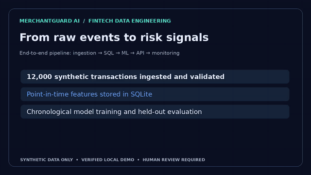
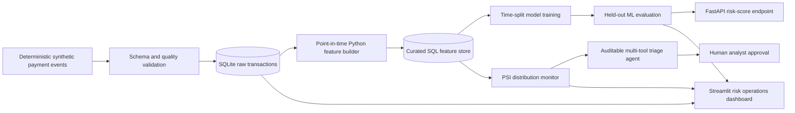

<div align="center">

# 🛡️ MerchantGuard AI
### Payment Risk Intelligence & Data Platform

**Python · SQL/SQLite · scikit-learn · FastAPI · Streamlit · CI/CD · Data Quality · Drift Detection · Human-in-the-loop Agent**

*A working fintech-oriented portfolio project, designed to demonstrate the data science + data engineering lifecycle.*

[](assets/merchantguard-walkthrough.mp4)

**▶ [PLAY THE VIDEO DEMO (MP4)](assets/merchantguard-walkthrough.mp4)** · [Open dashboard screenshot](assets/merchantguard-demo.png)

*The MP4 is a short visual walkthrough of results from a verified local run (not a live screen recording). The animated GIF above plays directly inside GitHub's README. Both are bundled in this repository.*

</div>

> **Privacy and provenance:** All merchants, transactions, labels, amounts, and outcomes are **synthetically generated**. MerchantGuard is an independent educational prototype; it is not affiliated with Helcim, is not a Helcim integration, has not processed actual payments, is not PCI-DSS-certified, and must not determine real merchant access or customer transactions.

## 🎯 Why this exists

A payment-risk score is useful only if the underlying event data can be trusted, the model is evaluated honestly, an API can serve it, and a human can investigate when the incoming data changes. This repository demonstrates that end-to-end lifecycle instead of showing only a model notebook.

### At a glance — measured on the bundled reproducible 12,000-row synthetic scenario

| Metric | Observed result | How to interpret |
|---|---:|---|
| Raw events ingested and validated | 12,000 | Idempotent SQLite loading |
| Point-in-time-safe engineered features | 13 | Historical 24-hour velocity, account context, AVS/CVV and more |
| Chronologically held-out test events | 1,800 | Test data later in time than training and validation |
| ROC-AUC | **0.7708** | Synthetic-distribution discrimination only |
| PR-AUC (average precision) | **0.1023** | More meaningful for rare positive labels |
| Test-set simulated positive prevalence | **2.39%** | Baseline (not real-world fraud rate) |
| Flagged transactions with positive labels | **14.71%** | At a validation-derived ~2% review-budget threshold |
| Drift alerts in demo | **2** | Feature shifts deliberately injected for the demo |
| Automated test cases | **15** | Unit, API, pipeline, model, monitoring, and agent tests |

Performance changes with seed, library version, and simulated population. These are **demonstration metrics, not production fraud-detection claims**.

## Architecture



**Operational principles**

- **Repeatable** — seeded generation, JSON run report, CI, tests, dependency bounds.
- **Idempotent** — repeated ingestion skips existing transaction IDs; late-arriving events trigger a deterministic feature rebuild.
- **Time-aware** — merchant/customer 24-hour history excludes the transaction being scored; chronological train/validation/test split avoids random future-to-past train leakage.
- **Risk-aware** — prediction returns a *review suggestion*, never an automatic fraud verdict; the assistant only recommends investigation steps.
- **Observable** — population stability index (PSI) checks feature shifts; SQL audit tables record pipeline runs, alerts and investigations.
- **Candid** — the optional GCP example is a deployment blueprint, not proof of a live cloud deployment.

## ⚡ Quick start

**Requirements:** Python 3.10+, pip. Dependencies are specified in `pyproject.toml`.

```bash
git clone https://github.com/anhads3ngh/MerchantGuard-AI.git
cd MerchantGuard-AI
python -m venv .venv
source .venv/bin/activate  # Windows: .venv\Scripts\activate
pip install -e '.[dev,dashboard]'

# Complete end-to-end workflow: generation, validation, ETL, ML,
# prediction storage, simulated drift, human-reviewed agent trace
python -m merchantguard demo --rows 12000

# All automated tests
python -m pytest

# Backend and interactive API docs
uvicorn merchantguard.api:app --reload --port 8000
# http://127.0.0.1:8000/docs

# In a second terminal: interactive dashboard
streamlit run dashboard.py
# http://localhost:8501
```

If you installed the package, you can use `merchantguard demo` instead of `python -m merchantguard demo`.

**Generated local artifacts** in `.merchantguard/` (ignored from git): `synthetic_payments.csv`, `payments.db`, `risk_model.joblib`, `model_metadata.json`, `run_report.json`.

### Example scoring request

```bash
curl -s http://127.0.0.1:8000/predict \
  -H 'Content-Type: application/json' \
  -d '{
    "amount": 530.75,
    "hour": 2,
    "day_of_week": 4,
    "card_present": 0,
    "international": 1,
    "avs_match": 0,
    "cvv_match": 1,
    "account_age_days": 4,
    "merchant_age_days": 320,
    "merchant_txns_24h": 8,
    "customer_txns_24h": 2,
    "merchant_declines_24h": 1,
    "merchant_category": "ecommerce"
  }'
```

Useful endpoints: `GET /health`, `GET /model/metrics`, `GET /merchants/overview`, `GET /alerts`, `POST /investigate/latest`, `POST /predict`. Invalid inputs return HTTP 422; scoring without a trained model returns 503 and an actionable error.

## 🔎 Inside the pipeline

**1. Generate / validate.** Merchant IDs, customer pseudonyms, categories, card-present/online context, authorization responses, lognormal transaction amounts, and imbalanced synthetic fraud labels. Strict schema and range checks reject invalid rows; no real card details are ever generated.

**2. Ingest / transform.** `transactions`, `features`, `predictions`, `pipeline_runs`, `alerts`, `investigations` are separate SQLite entities. The transaction ID is a stable primary key. The feature builder uses deque-backed trailing windows and excludes the current event before calculating history; event times, not arrival order, determine historical features.

**3. Model / measure.** The model uses a preprocessing pipeline (imputation, scaling, categorical one-hot encoding) and logistic regression. A 70/15/15 chronological split trains on the earliest events, chooses a ~2% manual review capacity on validation, then evaluates the final score on later held-out events. Reports include PR-AUC, ROC-AUC, recall and precision at review capacity.

**4. Monitor / investigate.** PSI compares later transactions with training-derived numeric feature histograms; `--simulate-shift` injects a demonstrative difference into monitoring inputs *without modifying original events*. The investigation agent calls explicit tools (alert retrieval → data-quality query → merchant summary), writes an audit trace, and suggests *human* review. It is a deterministic **agent-style tool workflow**, not a claimed autonomous LLM integration.

**5. Serve / observe.** FastAPI exposes validated scoring and diagnostics. The optional Streamlit dashboard shows throughput, synthetic fraud share, merchant volumes, prediction scores and monitoring alerts.

### CLI workflows

```bash
python -m merchantguard demo --rows 12000 --seed 2027 --no-shift
python -m merchantguard ingest path/to/your_schema_compatible_data.csv
python -m merchantguard features
python -m merchantguard train
python -m merchantguard monitor --simulate-shift
python -m merchantguard triage
```

Note: `demo` resets its **configured local demo database**; use an isolated `MERCHANTGUARD_HOME` when retaining other runs. A CSV should contain the same columns as the generated synthetic dataset. Real customer data must not be supplied to this educational system.

## ☁️ Cloud deployment blueprint (optional)

The repository includes a Dockerfile and a **Cloud Build example** in `deploy/`. They demonstrate container packaging and image build structure for **Google Cloud Run**, but no live GCP environment is provisioned by this repository.

| Prototype | Production direction |
|---|---|
| Local SQLite | Cloud SQL (PostgreSQL) with migrations/backups |
| Local model file | Versioned GCS/Vertex AI model registry and immutable releases |
| FastAPI in Docker | Authenticated Cloud Run with workload identities |
| CLI batch steps | Cloud Run Jobs / Composer / Scheduler with retries and dead-letter handling |
| PSI + local audit | Cloud Monitoring alerts, centralized logs and lineage |
| Deterministic triage | Optional governed LLM agent with tool allowlist, evaluation and human approval |

**Docker showcase:** `docker build -f deploy/Dockerfile -t merchantguard . && docker run -p 8080:8080 merchantguard` includes only seeded synthetic demo artifacts. Container-local SQLite is ephemeral and **not an acceptable production persistence layer**. To go live, implement RBAC, encryption, secrets management, privacy reviews, least privilege, model governance, delayed-label monitoring and robust data retention.

## 🧪 Test coverage & limitations

- Simulated events are stable for the same seed, validated and chronologically sorted.
- Database ingestion is idempotent and invalid data is filtered.
- Point-in-time features cannot see the current decline or post-event fraud label.
- Train/validation/test are chronological; validation controls the score threshold.
- Monitoring detects a known distribution shift and sends it for human investigation.
- API handles healthy operation, schema errors and limit validation.

**Important limitations:** Synthetic fraud mechanisms do not represent real payment fraud, changing attack patterns, class imbalance by segment, chargeback-label delay, dispute resolution, costs of false positives or group fairness. The showcase has no payment data integration, security audit, live deployment, or proven business impact. An actual financial-risk product requires risk/compliance stakeholders, data contracts, restricted features, robust latency/error budgets, extensive testing and authorization before rollout.

## Next enhancements

1. Postgres + dbt transformations and durable object storage.
2. Feature contract tests for schema evolution and late-arriving event backfills.
3. Calibration metrics, cost-sensitive thresholds, segment fairness/drift diagnostics, delayed-label evaluation.
4. Canary model serving, authenticated endpoints, full request tracing and alert routing.
5. Optional LangGraph/ADK powered reasoning with a strict tool allowlist and human approval gates.

---

**Built as an independent educational portfolio system.** No relationship to or endorsement by any payments company is implied.
